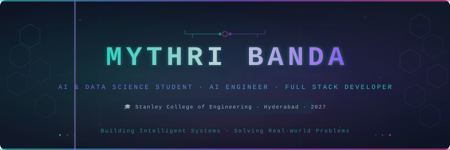
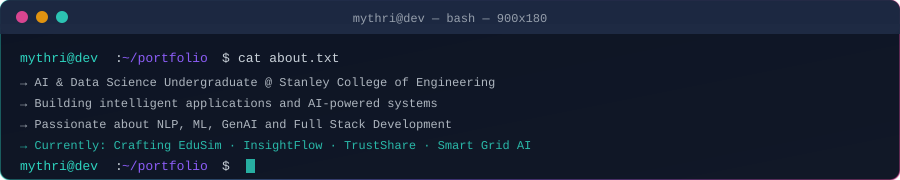
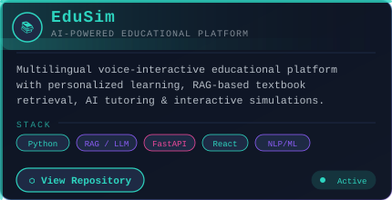
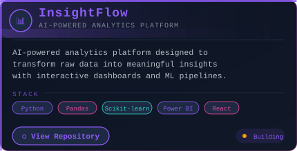
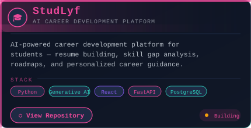
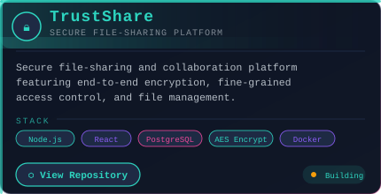
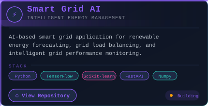
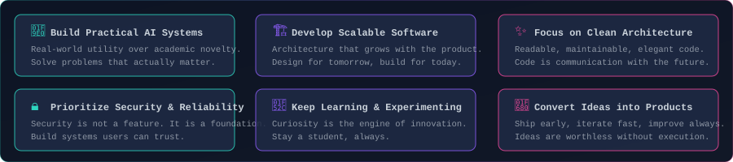
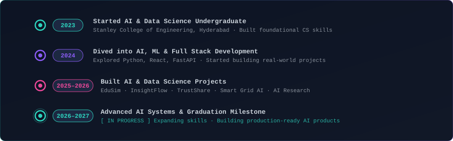
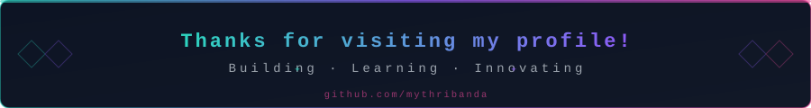

<!-- ═══════════════════════════════════════════════════════════════════════
     MYTHRI BANDA — GitHub Profile README
     ═══════════════════════════════════════════════════════════════════════ -->

<div align="center">

<!-- ╔══════════════════════════════════╗ -->
<!--   HEADER BANNER                     -->
<!-- ╚══════════════════════════════════╝ -->



<br/>

<!-- ── Social Badges ── -->

[](https://github.com/mythribanda)
[](https://linkedin.com/in/mythribanda)
[](mailto:mythribanda@gmail.com)
[](https://mythribanda.dev)

<br/>

<!-- ── Visitor Counter ── -->


</div>

<br/>

---

<!-- ╔══════════════════════════════════╗ -->
<!--   ABOUT ME                          -->
<!-- ╚══════════════════════════════════╝ -->


<br/>

<div align="center">

</div>

<br/>

<table>
<tr>
<td width="55%" valign="top">

```yaml
# mythri.yaml
name        : Mythri Banda
role        : AI & Data Science Undergraduate
institution : Stanley College of Engineering
              and Technology for Women
location    : Hyderabad, India
graduation  : 2027

focus:
  - Artificial Intelligence & Machine Learning
  - Natural Language Processing
  - Generative AI & LLM Systems
  - Full Stack Web Development
  - Data Analytics & Visualization

currently_building:
  - EduSim    # multilingual AI education platform
  - InsightFlow # AI-powered analytics
  - TrustShare  # secure file collaboration
  - Smart Grid AI # renewable energy forecasting

interests:
  - RAG-based retrieval systems
  - AI-powered product engineering
  - Open-source contribution
  - Research-driven development
```

</td>
<td width="45%" valign="top">

<br/>

**Hi there, I'm Mythri** 👋

I'm an **AI & Data Science undergraduate** at Stanley College of Engineering and Technology for Women, Hyderabad, graduating in 2027.

I'm passionate about building **intelligent applications** that sit at the intersection of machine learning, data science, and full-stack engineering. For me, AI is not just a research topic — it is a toolkit for solving real problems people face every day.

My work spans **NLP**, **RAG-based systems**, **generative AI**, **data analytics platforms**, and **scalable backend APIs**. I believe the best software is born from clarity of purpose, clean architecture, and an obsession with the user's real need.

When I'm not writing code, I'm reading research papers, experimenting with new model architectures, or planning the next project that makes me slightly too excited to sleep.

> *"Build things that matter. Learn until it clicks. Ship before it's perfect."*

</td>
</tr>
</table>

<br/>

---

<!-- ╔══════════════════════════════════╗ -->
<!--   TECH ARSENAL                      -->
<!-- ╚══════════════════════════════════╝ -->


<br/>

<div align="center">

<!-- ── Programming Languages ── -->

**`</>` &nbsp; Programming Languages**

<br/>

[](https://python.org)&nbsp;
[](https://java.com)&nbsp;
[](https://en.wikipedia.org/wiki/C_(programming_language))&nbsp;
[](https://developer.mozilla.org/en-US/docs/Web/JavaScript)&nbsp;
[](https://typescriptlang.org)&nbsp;
[](https://developer.mozilla.org/en-US/docs/Web/HTML)&nbsp;
[](https://developer.mozilla.org/en-US/docs/Web/CSS)

<br/><br/>

<!-- ── AI & Data Science ── -->

**`🤖` &nbsp; AI & Data Science**

<br/>

[](https://tensorflow.org)&nbsp;
[](https://scikit-learn.org)&nbsp;
[](https://pytorch.org)

<br/>

&nbsp;
&nbsp;
&nbsp;
&nbsp;
&nbsp;
&nbsp;


<br/><br/>

<!-- ── Frontend ── -->

**`🎨` &nbsp; Frontend Development**

<br/>

[](https://react.dev)&nbsp;
[](https://vitejs.dev)&nbsp;
[](https://tailwindcss.com)

<br/><br/>

<!-- ── Backend ── -->

**`⚙️` &nbsp; Backend Development**

<br/>

[](https://fastapi.tiangolo.com)&nbsp;
[](https://flask.palletsprojects.com)&nbsp;
[](https://nodejs.org)

<br/><br/>

<!-- ── Databases ── -->

**`🗄️` &nbsp; Databases**

<br/>

[](https://postgresql.org)&nbsp;
[](https://mysql.com)&nbsp;
[](https://firebase.google.com)

<br/><br/>

<!-- ── Tools ── -->

**`🛠️` &nbsp; Tools & Platforms**

<br/>

[](https://git-scm.com)&nbsp;
[](https://github.com)&nbsp;
[](https://docker.com)&nbsp;
[](https://code.visualstudio.com)&nbsp;
[](https://jupyter.org)

<br/>

&nbsp;


</div>

<br/>

---

<!-- ╔══════════════════════════════════╗ -->
<!--   FEATURED PROJECTS                 -->
<!-- ╚══════════════════════════════════╝ -->


<br/>

<!-- ── Row 1 ── -->

<div align="center">
<table>
<tr>
<td align="center" width="50%">

<a href="https://github.com/mythribanda/EduSim">
  
</a>

</td>
<td align="center" width="50%">

<a href="#">
  
</a>

</td>
</tr>

<!-- ── Row 2 ── -->
<tr>
<td align="center" width="50%">

<a href="#">
  
</a>

</td>
<td align="center" width="50%">

<a href="#">
  
</a>

</td>
</tr>
</table>
</div>

<!-- ── Row 3 centred ── -->

<div align="center">
<table>
<tr>
<td align="center" width="50%">

<a href="#">
  
</a>

</td>
<td width="50%">

<!-- Empty cell for balanced grid -->

</td>
</tr>
</table>
</div>

<br/>

<!-- ── Collapsible More Projects ── -->

<details>
<summary><b>🗂️ &nbsp; More Projects (click to expand)</b></summary>

<br/>

| Project | Description | Stack | Status |
|---------|------------|-------|--------|
| **mythribanda** | GitHub Profile README | SVG · Markdown · HTML | ✅ Live |
| *(More coming soon…)* | Active development | Python · React · AI | 🔨 Building |

<br/>

> All projects are built with a focus on real-world utility, clean code, and production readiness.

</details>

<br/>

---

<!-- ╔══════════════════════════════════╗ -->
<!--   ENGINEERING PHILOSOPHY            -->
<!-- ╚══════════════════════════════════╝ -->


<br/>

<div align="center">

</div>

<br/>

---

<!-- ╔══════════════════════════════════╗ -->
<!--   MY JOURNEY                        -->
<!-- ╚══════════════════════════════════╝ -->


<br/>

<div align="center">

</div>

<br/>

---

<!-- ╔══════════════════════════════════╗ -->
<!--   GITHUB ACTIVITY                   -->
<!-- ╚══════════════════════════════════╝ -->


<br/>

<div align="center">

<!-- ── GitHub Stats Row ── -->

<table>
<tr>
<td align="center">

[](https://github.com/mythribanda)

</td>
<td align="center">

[](https://github.com/mythribanda)

</td>
</tr>
</table>

<br/>

<!-- ── GitHub Streak ── -->

[](https://git.io/streak-stats)

<br/>

<!-- ── Contribution Graph ── -->

[](https://github.com/mythribanda)

<br/>

<!-- ── Snake Animation ── -->

> **Contribution Snake** *(updates daily via GitHub Actions)*

<picture>
  <source media="(prefers-color-scheme: dark)"
          srcset="https://raw.githubusercontent.com/mythribanda/mythribanda/output/github-contribution-grid-snake-dark.svg"/>
  <source media="(prefers-color-scheme: light)"
          srcset="https://raw.githubusercontent.com/mythribanda/mythribanda/output/github-contribution-grid-snake.svg"/>
  
</picture>

</div>

<br/>

> **ℹ️ Note on stats:** These cards reflect live data from the GitHub API. Counts and streaks update automatically as activity grows.

<br/>

---

<!-- ╔══════════════════════════════════╗ -->
<!--   CERTIFICATIONS                    -->
<!-- ╚══════════════════════════════════╝ -->


<br/>

<div align="center">

<table>
<tr>

<td align="center" width="25%">

<br/>


**Oracle Certified**<br/>**Data Science Professional**

<sub></sub>

</td>

<td align="center" width="25%">

<br/>


**Oracle AI Foundations**<br/>**Associate**

<sub></sub>

</td>

<td align="center" width="25%">

<br/>


**IBM AI**<br/>**Fundamentals**

<sub></sub>

</td>

<td align="center" width="25%">

<br/>


**Cisco AI**<br/>**Fundamentals**

<sub></sub>

</td>

</tr>
</table>

</div>

<br/>

---

<!-- ╔══════════════════════════════════╗ -->
<!--   FOOTER                            -->
<!-- ╚══════════════════════════════════╝ -->

<div align="center">



<br/>

<!-- ── Footer Social Icons ── -->

[](https://github.com/mythribanda)&nbsp;
[](https://linkedin.com/in/mythribanda)&nbsp;
[](mailto:mythribanda@gmail.com)&nbsp;
[](https://mythribanda.dev)

<br/>

<sub>
Designed &amp; built with ♥ by <strong>Mythri Banda</strong> &nbsp;·&nbsp;
<a href="https://github.com/mythribanda/mythribanda">View Source</a> &nbsp;·&nbsp;
Last updated: 2026
</sub>

</div>

<!-- ═══════════════════════════════════════════════════════════════════════
     END OF README
     ═══════════════════════════════════════════════════════════════════════ -->
